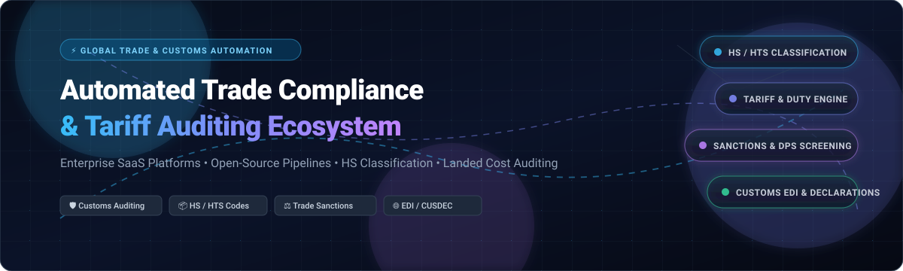

<p align="center">
  
</p>

<p align="center">
  <a href="https://github.com/ishandutta2007/Awesome-Awesome-Awesome"></a><a href="https://discord.gg/jc4xtF58Ve"></a>
  <a href="https://github.com/ishandutta2007/Awesome-Automated-Trade-Compliance-Tariff-Auditing/stargazers"></a>
  <a href="https://github.com/ishandutta2007/Awesome-Automated-Trade-Compliance-Tariff-Auditing/network/members"></a>
  <a href="https://github.com/ishandutta2007/Awesome-Automated-Trade-Compliance-Tariff-Auditing/blob/main/LICENSE"></a>
  <a href="https://github.com/ishandutta2007/Awesome-Automated-Trade-Compliance-Tariff-Auditing/pulls"></a>
  <a href="https://github.com/ishandutta2007"></a>
</p>

---

# 🚢 Awesome Automated Trade Compliance & Tariff Auditing 🌐

> A curated directory of **Enterprise SaaS Platforms**, **Open-Source GitHub Projects**, and **API Pipelines** engineered for automated **Harmonized System (HS / HTS) classification**, **customs tariff & duty calculation**, **denied/restricted party screening**, **cross-border landed cost estimation**, and **customs declaration filings**.

Whether you are a **trade compliance officer**, **customs broker**, **supply chain engineer**, or **software developer**, this guide catalogs enterprise-grade vendors and open tools to build audit-proof international trade workflows.

---

## 📑 Table of Contents
- [📊 Sector Overview & Market Dynamics](#-sector-overview--market-dynamics)
- [🏢 SaaS & Hosted Platforms](#-saas--hosted-platforms)
- [💻 Open-Source GitHub Projects](#-open-source-github-projects)
- [🏗️ Self-Hosted Architecture Blueprint](#️-self-hosted-architecture-blueprint)
- [🤝 How to Contribute](#-how-to-contribute)
- [⭐ Star History](#-star-history)
- [💖 Support & Community](#-support--community)
- [⚖️ Regulatory Disclaimer](#️-regulatory-disclaimer)

---

## 📊 Sector Overview & Market Dynamics

The **Global Trade Management (GTM) and Automated Trade Compliance software market** is estimated at **$1.31B to $1.45B in 2025–2026** and is expanding at a robust **compound annual growth rate (CAGR) of 9.9% to 11.4%**, projected to surpass **$2.4B by 2030**. Growth is propelled by accelerating cross-border trade, geopolitical tariff volatility, complex Free Trade Agreements (FTAs), Section 301/232 duties, and heightened customs penalties for misclassification.

From a market structure perspective, the sector is **moderately concentrated at the enterprise upper tier** — where top market leaders (such as Thomson Reuters, WiseTech Global, Descartes Systems Group, SAP, and E2open) capture approximately 55% to 60% of total industry revenue. This enterprise concentration is reinforced by massive multi-year contracts, mission-critical legal liability, and deep ERP integration barriers. Conversely, the market remains **highly fragmented in the mid-market and SME segments**, where specialized regional customs brokers, niche customs-filing SaaS platforms, and modern headless duty-calculation APIs compete actively.

---

## 🏢 SaaS & Hosted Platforms

The following SaaS platforms provide commercial, cloud-hosted trade compliance, tariff auditing, automated HS code classification, and electronic customs filing. 

*Table sorted in **descending order by company size** (Market Capitalization / Valuation / Annual Revenue).*

| 🏷️ Platform / Solution | 🏢 Provider | 💰 Company Size (Valuation / Revenue) | 💳 Starting Tier Pricing | 🎁 Free Tier / Trial Limits | 🎯 Primary Capabilities &amp; Coverage |
| :--- | :--- | :--- | :--- | :--- | :--- |
| [**ONESOURCE Global Trade**](https://tax.thomsonreuters.com/en/onesource/global-trade-management) | Thomson Reuters | **~$85.0B** Market Cap (NYSE: TRI) / **~$7.1B** Annual Revenue | **$1,500 / month** ($18,000/yr annual agreement for base classification &amp; screening) | **30-day free trial** for Denied Party Screening (DPS) &amp; Trade Lane Analyser (up to 250 test screenings upon sales verification) | Global commodity classification, Free Trade Agreement (FTA) qualification, denied party screening, and ERP-integrated customs filing in 220+ countries. |
| [**CargoWise**](https://www.wisetechglobal.com/products/cargowise/) | WiseTech Global | **~$18.5B USD** / $28.5B AUD Market Cap (ASX: WTC) / **~$750M USD** Annual Revenue | **$9.95 / transaction** (standalone customs declaration entry fee under Value Pack tier; unlimited user seats) | **100% free lifetime access** to WiseTech Academy trade certification courses &amp; customs compliance modules (software requires contract) | Enterprise logistics execution, automated customs clearance, multi-country declaration filing, tariff scheduling, and freight auditing. |
| [**Descartes CustomsInfo &amp; Visual Compliance**](https://www.descartes.com/) | The Descartes Systems Group | **~$9.2B** Market Cap (NASDAQ: DSGX) / **~$620M** Annual Revenue | **$50 / user / month** ($600/user/yr) or **$208 / month** for Visual Compliance Essential tier | **14-day free trial** on Descartes Visual Compliance with up to 100 automated entity and denied party screening checks | Automated HS/HTS classification, international duty &amp; VAT calculation, restricted party screening, and electronic declaration filing. |
| [**Integration Point**](https://tax.thomsonreuters.com/en/onesource/global-trade-management) | Thomson Reuters | **~$85.0B** Parent Valuation / **~$100M+** Division Revenue | **$1,250 / month** ($15,000/yr annual contract for core tariff schedules &amp; compliance) | **14-day guided sandbox access** for up to 50 test classification queries under enterprise evaluation | Comprehensive global tariff database, import/export management, FTA qualification rules, and supply chain regulatory compliance. |
| [**QAD Precision GTM**](https://www.qad.com/precision) | Thoma Bravo / QAD Inc. | **~$2.0B** Private Valuation (Thoma Bravo) / **~$350M** Annual Revenue | **$150 / user / month** (minimum 10 users, ~$18,000/yr base contract) | **30-day proof-of-concept trial** plus 1 complimentary Foreign-Trade Zone (FTZ) cost/benefit compliance audit | Global trade &amp; transportation execution, customs filing, restricted party screening, landed cost calculation, and FTZ administration. |
| [**E2open (Amber Road)**](https://www.e2open.com/solutions/global-trade-management/) | E2open Parent Holdings | **~$1.3B** Market Cap (NYSE: ETWO) / **~$635M** Annual Revenue | **$12,500 / month** ($150,000/yr enterprise subscription for core GTM &amp; filing) | **14-day sandbox access** for enterprise compliance teams with a 500-transaction simulation limit | Automated customs filing, tariff simulation, export management, denied party screening, and global multi-tier trade agreement management. |
| [**Livingston International**](https://www.livingstonintl.com/) | Platinum Equity | **~$1.2B** Private Valuation / **~$450M** Annual Revenue | **$125 / entry** (online customs clearance portal base fee; volume scale down to $45/entry) | **Free forever access** to web-based customs brokerage estimation calculator + 1 complimentary compliance risk assessment | Customs brokerage, automated entry preparation, duty drawback auditing, Harmonized Tariff Schedule classification, and trade advisory. |
| [**Zonos Classify &amp; Landed Cost**](https://zonos.com/) | Zonos Inc. | **~$250M** Private Valuation / **~$45M+** Annual Revenue | **$500 / month** for Classify API (or **$2.00 / order + 10%** duty guarantee for checkout Landed Cost) | **Free tier forever** with 1,000 complimentary automated HS code classifications upon dashboard registration | AI-powered HS/HTS code classification, guaranteed cross-border landed cost calculation, IOSS/UK VAT compliance, and carrier labeling. |
| [**MIC Customs Solutions**](https://www.mic-cust.com/) | MIC Customs Solutions | **~$200M** Private Valuation / **~$85M+** Annual Revenue | **$2,500 / month** base license for single-country MIC-CUST declaration filing | **30-day guided pilot sandbox** for up to 50 test customs declarations under NDA | Modular customs clearance software, tariff classification engine, preferential origin calculation, and export control management across 55+ countries. |
| [**OCR Global EASE**](https://www.ocr-inc.com/) | OCR Services, Inc. | **~$75M** Private Valuation / **~$35M** Annual Revenue | **$50 / user / month** (billed annually at $600/user/yr) for core watchlist screening &amp; classification | **14-day trial evaluation** for trade teams with up to 50 test watchlist screenings | Watchlist screening, ECCN export licensing, automated commodity classification, and global import/export operational compliance. |
| [**TradeBeam GTM**](https://www.ignitetech.com/) | IgniteTech / Aptean | **~$20M** Division Revenue (Parent Aptean Valuation ~$3.0B) | **$1,200 / month** for core multi-tier import/export regulatory tracking &amp; compliance | **14-day guided proof-of-concept** evaluation covering up to 25 cross-border compliance shipments | Global trade management, duty &amp; tariff optimization, export compliance screening, and supplier collaborative compliance. |
| [**CustomsCity**](https://www.customscity.com/) | CustomsCity Global | **~$15M** Private Valuation / **~$3M** Annual Revenue | **Free Plan ($0 / month)** for 10 entries; Grow Plan starts at **$49 / month** for 99 transactions (~$0.49/entry) | **Free tier forever** with 10 CBP filings/month included; plus **30-day free trial** on all paid plans | Cloud customs clearance filing (ABI, Type 01, eManifest, CBP Automated MID, FDA Prior Notice) with direct CBP ACE connectivity. |
| [**SimplyDuty**](https://www.simplyduty.com/) | SimplyDuty Ltd | **~$5M** Private Valuation / **~$1.5M** Annual Revenue | **£0.10 (~$0.13) / API call**, or monthly bundle starting at **£25 / month** (~$32/mo) for 300 lookups | **Free tier forever** providing 5 free HS code lookups and customs duty calculations per day | Lightweight HS code lookup API and global customs duty &amp; import tax calculation for e-commerce checkouts and catalog indexing. |

---

## 💻 Open-Source GitHub Projects

Explore verified open-source repositories, developer toolkits, customs message parsers, and regulatory datasets for building self-hosted, vendor-independent trade compliance pipelines.

*Table sorted in **descending order by GitHub Star Count**.*

| 📦 Repository &amp; Stargazers | 🌟 Star Badge | 📜 License | 🛠️ Tech Stack | 📖 Purpose &amp; Trade Compliance Role |
| :--- | :--- | :--- | :--- | :--- |
| [**n8n-io/n8n**](https://github.com/n8n-io/n8n) | [](https://github.com/n8n-io/n8n/stargazers) | Fair-code / Sustainable Use | TypeScript / Node.js | Workflow automation engine for orchestrating end-to-end customs data pipelines, EDI parsing triggers, tariff API queries, and automated compliance alert webhooks. |
| [**odoo/odoo**](https://github.com/odoo/odoo) | [](https://github.com/odoo/odoo/stargazers) | LGPL-3.0 | Python / JavaScript | Enterprise resource planning suite with automated landed cost calculation, customs valuation, import duty cost distribution vouchers, and multi-currency accounting. |
| [**frappe/erpnext**](https://github.com/frappe/erpnext) | [](https://github.com/frappe/erpnext/stargazers) | GPL-3.0 | Python / JavaScript | Free &amp; open-source ERP featuring comprehensive cross-border purchase orders, landed cost distribution voucher engines, and country-specific tax/duty rules. |
| [**jf-tech/omniparser**](https://github.com/jf-tech/omniparser) | [](https://github.com/jf-tech/omniparser/stargazers) | Apache-2.0 | Go | High-performance ETL stream parser and transform library specifically architected for ingestion of EDI (EDIFACT, X12), CSV, and XML customs declaration files. |
| [**openboxes/openboxes**](https://github.com/openboxes/openboxes) | [](https://github.com/openboxes/openboxes/stargazers) | EPL-1.0 | Java / Groovy | Supply chain and warehouse management system tracking international cross-border shipments, import lots, customs paperwork, and customs manifests. |
| [**opensanctions/opensanctions**](https://github.com/opensanctions/opensanctions) | [](https://github.com/opensanctions/opensanctions/stargazers) | CC-BY-4.0 | Python | Open database of international sanctions, politically exposed persons (PEPs), and denied trade entities for automated screening and export control compliance. |
| [**indice-co/EDI.Net**](https://github.com/indice-co/EDI.Net) | [](https://github.com/indice-co/EDI.Net/stargazers) | MIT | C# / .NET | .NET serialisation/deserialisation engine for EDIFACT (CUSDEC, CUSRES) and ANSI X12 (309, 311) customs documentation and declaration interchanges. |
| [**php-edifact/edifact**](https://github.com/php-edifact/edifact) | [](https://github.com/php-edifact/edifact/stargazers) | MIT | PHP | Open-source toolkit for parsing and generating UN/EDIFACT electronic data interchange messages for port authorities and customs authorities. |
| [**datasets/harmonized-system**](https://github.com/datasets/harmonized-system) | [](https://github.com/datasets/harmonized-system/stargazers) | Public Domain / CC0 | DataPackage / CSV | Standardized open Harmonized Commodity Description and Coding System (HS codes) dataset published as a Frictionless Data package for automated commodity classification. |
| [**uncomtrade/comtradeapicall**](https://github.com/uncomtrade/comtradeapicall) | [](https://github.com/uncomtrade/comtradeapicall/stargazers) | MIT | Python | Official Python client library for the UN Comtrade API, accessing global merchandise trade records, customs trade statistics, and international tariff rates. |
| [**julxxy/chinaport-data-signature**](https://github.com/julxxy/chinaport-data-signature) | [](https://github.com/julxxy/chinaport-data-signature/stargazers) | Apache-2.0 | Go | Open-source electronic port signing service for China Customs CEB declaration messages and Customs 179 real-time payment authentication. |
| [**ropensci/comtradr**](https://github.com/ropensci/comtradr) | [](https://github.com/ropensci/comtradr/stargazers) | MIT | R | R package providing automated extraction and pipeline processing of UN Comtrade commodity tariff and customs data for econometric and trade analysis. |
| [**SupplyGraphAI/supplygraph-ai**](https://github.com/SupplyGraphAI/supplygraph-ai) | [](https://github.com/SupplyGraphAI/supplygraph-ai/stargazers) | Apache-2.0 | Python / TypeScript | Open AI-native platform for automated customs &amp; HTS classification, tariff analysis, and multi-tier trade compliance risk intelligence. |
| [**alphagov/trade-tariff-backend**](https://github.com/alphagov/trade-tariff-backend) | [](https://github.com/alphagov/trade-tariff-backend/stargazers) | MIT | Ruby on Rails | UK Government's official open-source tariff calculation and commodity code classification engine powering HM Revenue &amp; Customs (HMRC) Trade Tariff service. |
| [**opsloft/tariff-resolver**](https://github.com/opsloft/tariff-resolver) | [](https://github.com/opsloft/tariff-resolver/stargazers) | MIT | TypeScript / Python | Model Context Protocol (MCP) server for US import duty research, HTS codes, Chapter 99 duties (Section 301 / IEEPA), and landed-cost math from official USITC data. |

---

## 🏗️ Self-Hosted Architecture Blueprint

To construct a scalable, self-hosted, enterprise-grade Automated Trade Compliance &amp; Tariff Auditing stack using the open-source building blocks above:

```
                  ┌────────────────────────────────────────┐
                  │       Inbound Commercial Invoice       │
                  │        (CSV / JSON / EDIFACT)          │
                  └───────────────────┬────────────────────┘
                                      │
                                      ▼
                  ┌────────────────────────────────────────┐
                  │   EDI Ingestion & ETL Parsing Engine   │
                  │   (jf-tech/omniparser or EDI.Net)      │
                  └───────────────────┬────────────────────┘
                                      │
                 ┌────────────────────┴────────────────────┐
                 │                                         │
                 ▼                                         ▼
   ┌───────────────────────────┐             ┌───────────────────────────┐
   │  HS Code Classification   │             │ Denied & Sanctions Audit  │
   │  (datasets/harmonized-    │             │ (opensanctions/           │
   │   system + LLM embeddings)│             │  opensanctions screening) │
   └─────────────┬─────────────┘             └─────────────┬─────────────┘
                 │                                         │
                 └────────────────────┬────────────────────┘
                                      │
                                      ▼
                  ┌────────────────────────────────────────┐
                  │    Tariff & Duty Calculation Engine    │
                  │   (alphagov/trade-tariff-backend /     │
                  │    uncomtrade/comtradeapicall)         │
                  └───────────────────┬────────────────────┘
                                      │
                                      ▼
                  ┌────────────────────────────────────────┐
                  │   ERP Landed Cost & Audit Persistence  │
                  │      (odoo/odoo or frappe/erpnext)     │
                  └────────────────────────────────────────┘
```

1. **Ingestion & Parsing:** Ingest vendor shipment manifests via [`jf-tech/omniparser`](https://github.com/jf-tech/omniparser) or [`indice-co/EDI.Net`](https://github.com/indice-co/EDI.Net) to normalize legacy EDIFACT CUSDEC/DESADV files.
2. **Restricted Party Screening:** Run customer and vendor entities through [`opensanctions/opensanctions`](https://github.com/opensanctions/opensanctions) to enforce OFAC, EU, and UN denied-party compliance.
3. **Automated Classification:** Query the 6-digit Harmonized System nomenclature from [`datasets/harmonized-system`](https://github.com/datasets/harmonized-system) combined with local tariff schedules.
4. **Duty & Tax Computation:** Calculate ad valorem tariffs, anti-dumping duties, and Section 301 surcharges using the reference algorithms from [`alphagov/trade-tariff-backend`](https://github.com/alphagov/trade-tariff-backend) and [`opsloft/tariff-resolver`](https://github.com/opsloft/tariff-resolver).
5. **Landed Cost Persistence:** Allocate freight, insurance, and duties to inventory valuation vouchers inside [`odoo/odoo`](https://github.com/odoo/odoo) or [`frappe/erpnext`](https://github.com/frappe/erpnext).

---

## 🤝 How to Contribute

Contributions are warmly welcomed! Help us keep this directory accurate, up-to-date, and comprehensive.

1. 🍴 **Fork the repository** on GitHub.
2. 🌿 **Create a new branch**: `git checkout -b feature/add-new-trade-tool`.
3. 📝 **Add or edit entries in `README.md`**:
   - Maintain the existing tabular schema.
   - For **SaaS tools**, ensure specific starting price figures and concrete free tier/trial limits are provided (avoid generic terms).
   - For **Open-Source tools**, ensure you include the star badge with `style=social&color=white` linked to the stargazers page.
4. 🧪 **Check link validity & formatting**.
5. 🚀 **Submit a Pull Request** with a concise description of the addition.

---

## ⭐ Star History

[](https://star-history.dera.page/#ishandutta2007/Awesome-Automated-Trade-Compliance-Tariff-Auditing&type=date&legend=top-left)

---

## 💖 Support & Community

Thank you for exploring and bookmarking the **Awesome Automated Trade Compliance & Tariff Auditing** project! 

If you find this repository valuable for your international trade operations, customs audits, or software pipelines:
* ⭐ **Star this repository** to help other supply chain engineers and compliance managers find it.
* 🍴 **Fork and share** it across your network and developer communities.
* ☕ **Buy me a coffee / Sponsor**: If this curated guide saved your team research hours and compliance headaches, support future research and continuous updates on the [GitHub Sponsor Dashboard](https://github.com/sponsors/ishandutta2007).

---

## ⚖️ Regulatory Disclaimer

*This repository is a community-curated educational and technical resource. It does not constitute legal, tax, customs brokerage, or financial advice. Customs regulations, Harmonized Tariff Schedule (HTS/TARIC) classification codes, Free Trade Agreement rules of origin, and sanctions lists change frequently across jurisdictions. Misclassification or erroneous duty calculations can trigger severe regulatory penalties, customs audits, shipment seizure, or revocation of import privileges. Always verify classifications and tariff rates against official government customs authorities (e.g., US CBP, EU TAXUD, UK HMRC) or consult a licensed customs broker.*
